# Lumix ZS100 controller

Copy photos and videos off a Panasonic Lumix ZS100 (TZ100) over Wi-Fi, browse them, and shoot remotely. Two front ends
talk to the camera's built-in Wi-Fi web server (protocol notes in [PROTOCOL.md](PROTOCOL.md)):

- **Android app** (`mobile/`, v2.0): talks to the camera directly, no PC needed. Gallery by day, search/filter/sort,
  zoomable viewer with EXIF details, background saving with a notification (resume/cancel), remote shooting (live view,
  shutter, zoom, video), optional GPS tagging, and auto-finding the camera. Android 10+.
- **PC web app** (`app/`): a standard-library Python server that copies files into a folder on the PC and serves a gallery to
  any device on the network. No dependencies, no build step.

The camera serves one client at a time, so use one app at a time.

## Screenshots

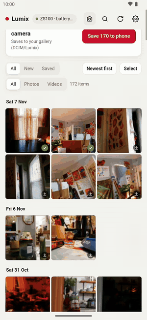 
Android app with a real ZS100 (33 s). <a href="docs/media/demo.mp4">MP4 version</a>.

| | Light | Dark |
|---|---|---|
| **Gallery**: day groups, filters, save banner | 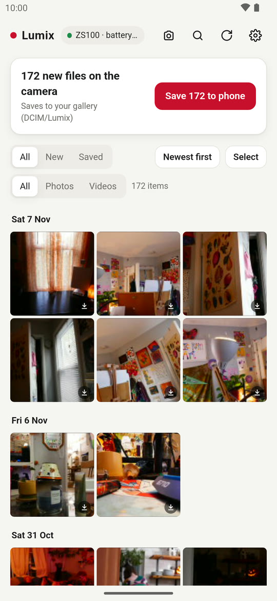 | 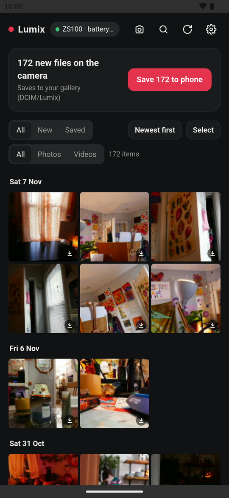 |
| **Viewer**: pinch/double-tap zoom, Full size, save | 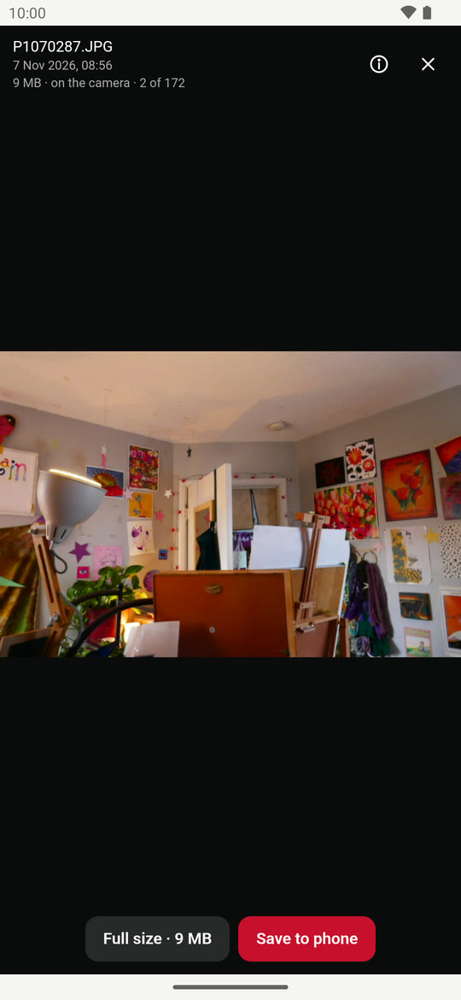 | 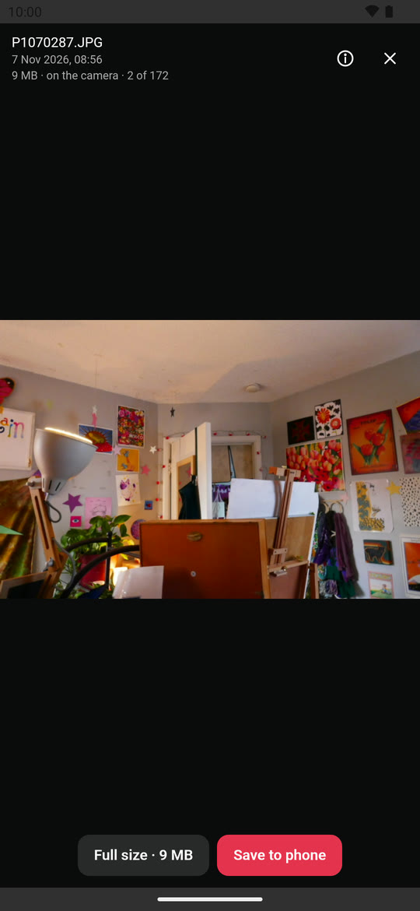 |
| **Details**: EXIF read from the camera or the saved file | 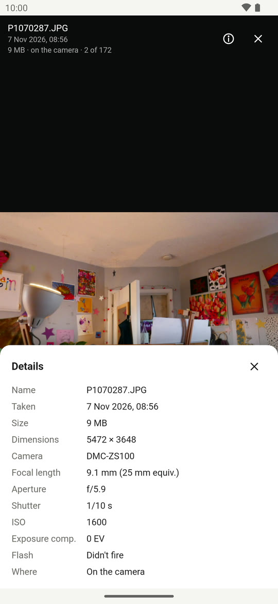 | 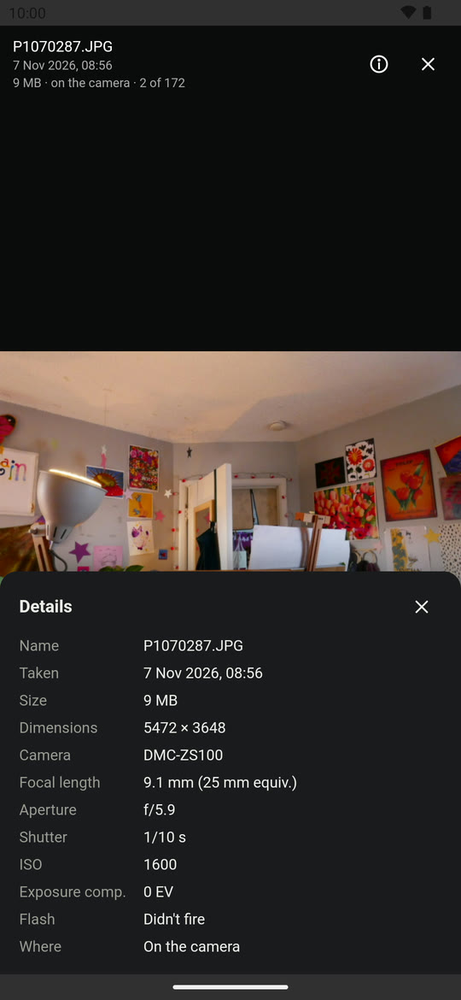 |
| **Selection**: long-press/drag, per day, select all | 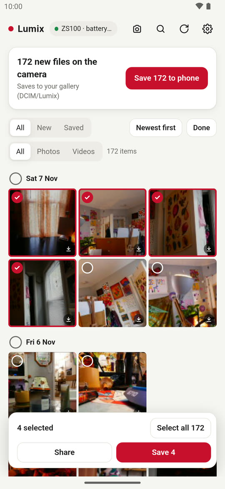 | 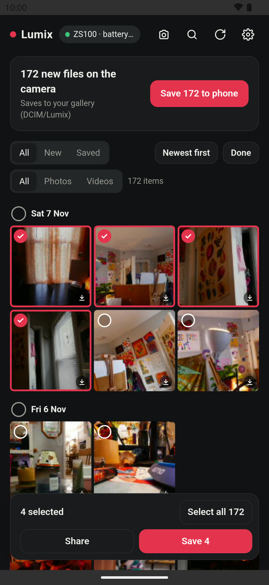 |
| **Background saving**: progress and Cancel in a notification | 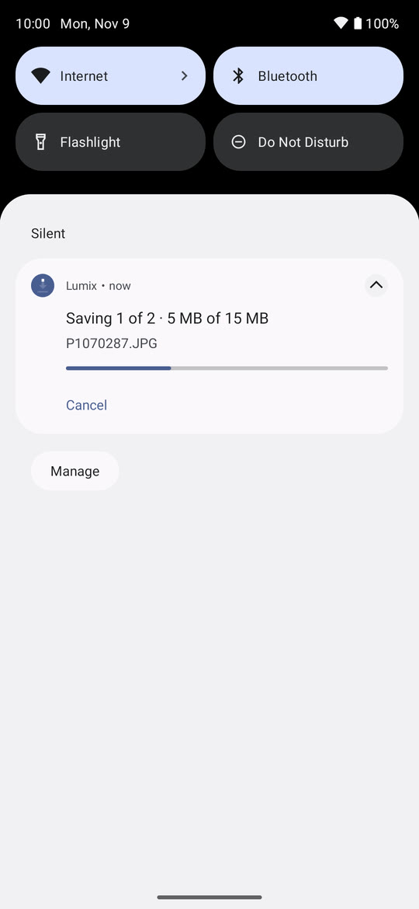 | 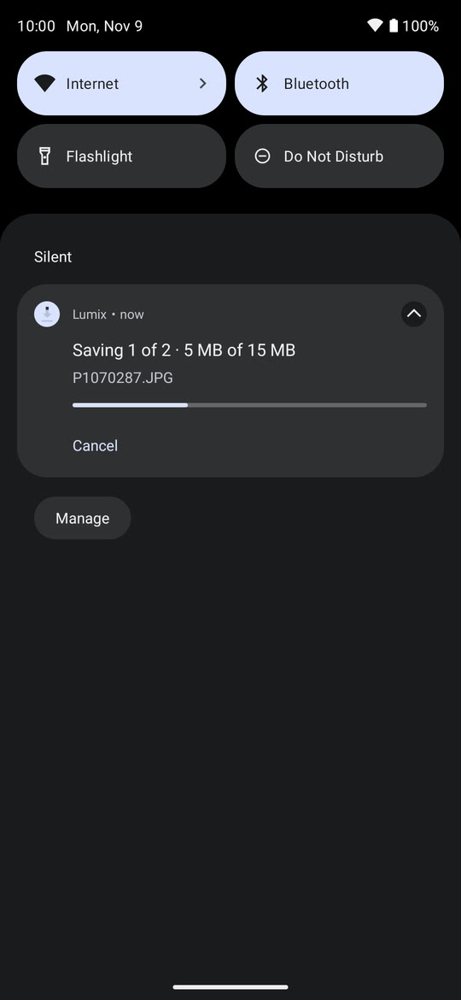 |
| **Remote**: live view, shutter, zoom, photo/video | 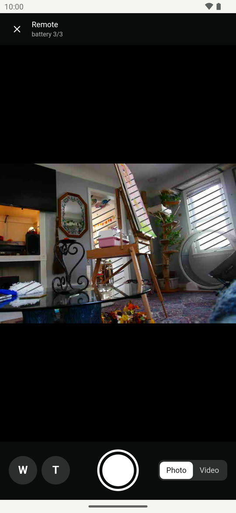 | 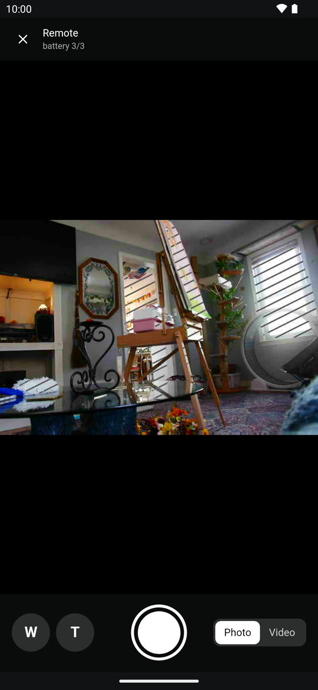 |

Captured on the `lumix_s23plus` emulator (Android 13) against the real camera over home Wi-Fi.

## Camera setup

Wi-Fi menu → Remote Shooting & View, and leave it on the waiting screen. Join your home network ("Via Network"; the camera
is then usually at a LAN address such as `10.0.0.220`) or use the camera's own hotspot (`192.168.54.1`). Both apps can find the camera
by themselves, and the address can be set manually in Settings.

## Android app

Download `lumix-<version>.apk` from the [Releases](../../releases) page and install it (allow installs from your browser/files app).
Updates install over the old app only if signed with the same key.

Build from source (Node 22, JDK 21, Android SDK 36): `sh mobile/build.sh` → `dist/lumix.apk`. Create your own signing key in
`mobile/keystore/` (gitignored) first and add `mobile/keystore/keystore.properties` (see `mobile/android/app/build.gradle`).

## PC web app

Download `lumix-pc-<version>.zip` from [Releases](../../releases), unzip, install [Python 3.9+](https://www.python.org/downloads/)
(tick "Add to PATH") and double-click `lumix.bat`. Open http://localhost:8420, or `http://<pc-ip>:8420` from a phone.
Photos go to `Pictures\Lumix` by default.

Or run it directly: `python3 app/server.py`. Environment: `LUMIX_PORT` (8420), `LUMIX_LIBRARY` (`/photos`), `LUMIX_DATA`
(`./data`), `LUMIX_CAMERA` (initial camera IP). Files are never deleted from the camera.

## Docs

[CLAUDE.md](CLAUDE.md) (architecture and dev setup), [PROTOCOL.md](PROTOCOL.md), `mobile/PLAN.md` (build log),
`mobile/tools/TESTING.md` (test checklist).
